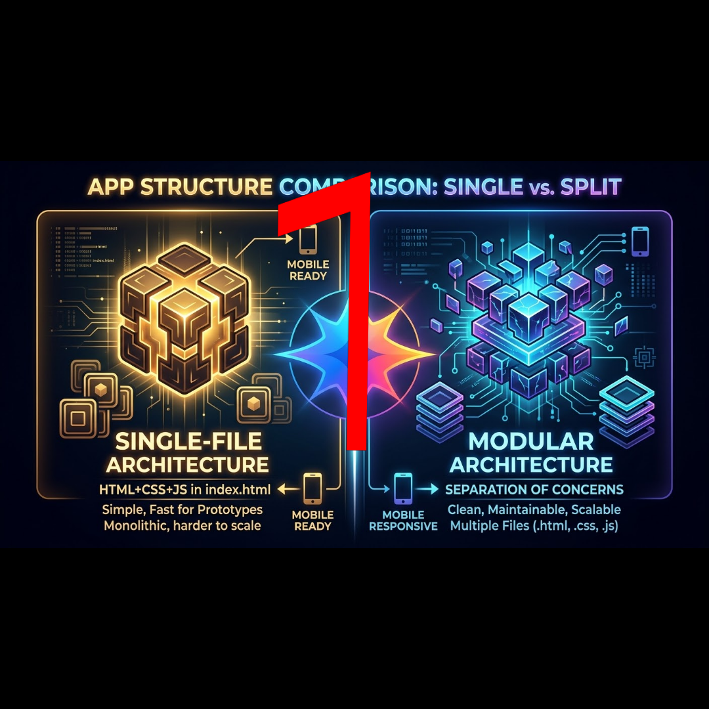
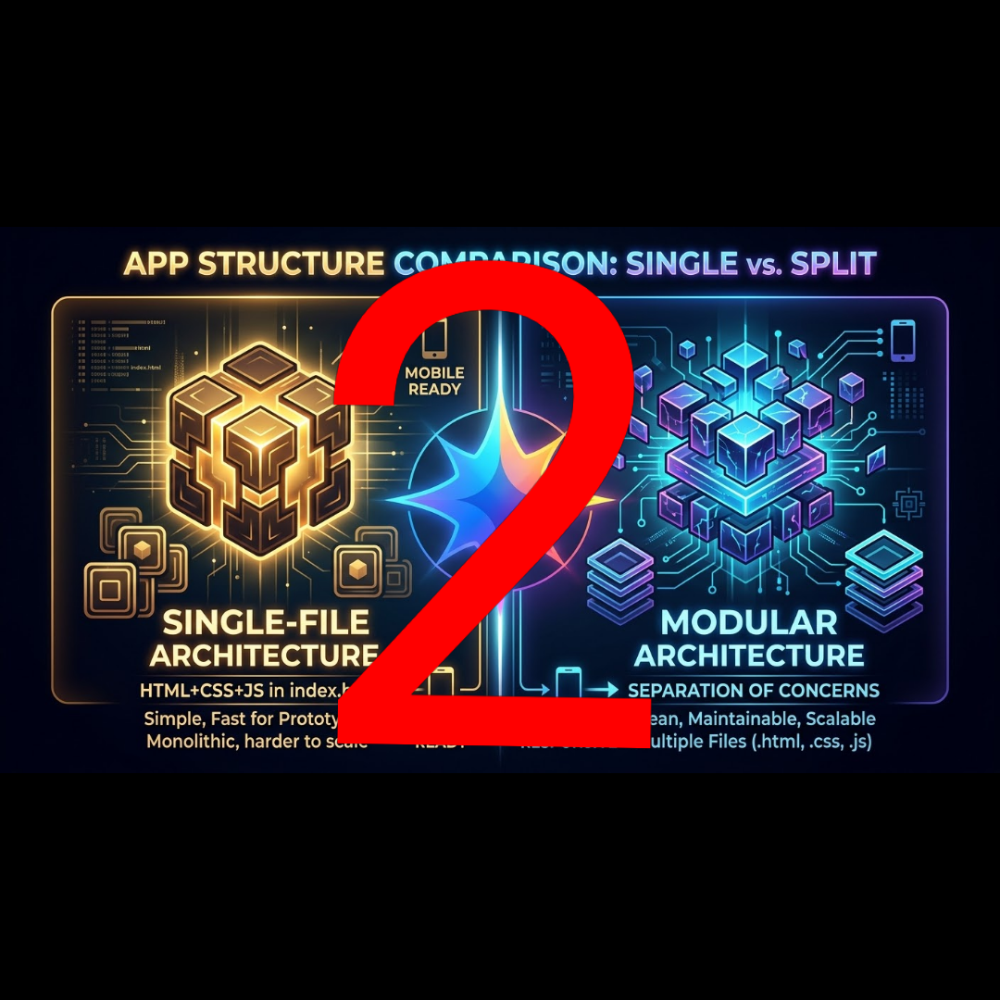

# Single-vs-Split
assets folder single html file vs split files architecture turned into apks 1 and 2  

  

  

  

see   https://github.com/AndroidCSOfficial/android-code-studio/releases/tag/v1.0.0%2Bgh.r4  

for building android apks inside android itself 

(Android Studio for Android OS)  <3!
